# Handover analysis 04 — Database schema and backend architecture

Snapshot taken 2026-11-13 at commit `f5940bc`. This was a read-only investigation: no database connection was made. Sources:

- **Live production**, treated as the source of truth for what exists:
  - `docs/handover/analysis/db-snapshot.json` (`generated_at` 2026-11-13T16:05:54Z), cited as `snap:<path>`.
  - `docs/handover/analysis/db-snapshot-grants.json` (`generated_at` 16:07:43Z), cited as `grants:<path>`.
- **Intent and function bodies:** `supabase/migrations/*.sql`, cited as `mig:<file>:<line>`. The snapshots list function signatures but not bodies, so all function logic below comes from the **latest** migration that defines each function. §10 confirms that each one is present live.
- **App usage:** `src/**`, cited as `file:line`.

No personal data or secrets appear here. Row counts are aggregates from `grants:counts`.

Related docs:
- Env vars and Brevo template params: [doc 02](./02-env-services-emails.md) §1 and §6.
- Auth URL configuration: [doc 03](./03-infra-domains.md) §4.
- Local dev and the risk of a `.env.local` pointing at production: [doc 01](./01-repo-stack-localdev.md) §7.

---

## 1. Tables

Production: 26 tables and 1 view in `public`, with RLS enabled on all 26 and forced on none (`snap:tables[*].rls_enabled/rls_forced`). There are 6 auth users (`snap:auth_user_count`).

**Row counts** come from `grants:counts` where available; otherwise they are the planner estimate `snap:tables[*].est_rows`, shown as "~n". An estimate of `-1` means the table was never analysed, shown as "?".

**PII** marks columns holding personal data: 👤 identity/contact, 📍 address/location, 🖼 photo, #️⃣ hashed IP, 📝 free text that may contain personal data.

| Table | Purpose | Key columns (PII marked) | Business rules in constraints | Rows |
|---|---|---|---|---|
| `bookings` | Customer pickup request and its lifecycle | `reference` (2W-XXXX), `status`, 👤`customer_name`, 👤`customer_phone`, 👤`customer_email`, 👤`whatsapp_phone`, 📍`pickup_address`, 📍`pickup_landmark`, 📍`pickup_map_url`, 📝`customer_notes`, `requested_date/time`, `express_requested`, `assigned_branch_id`, `agreed_pickup_at`, `agreed_fee`, `zero_fee_reason`, 📝`confirmation_note`, 📝`return_details`, 📝`cancellation_reason`, `version`, per-status timestamps, `expires_at` | Reference regex `^2W-([0-9A-HJKMNP-TV-Z]{4}\|…{10})$`. Cancelled ⇒ reason required. Fee ≥0, GHS only, fee 0 ⇒ `zero_fee_reason`. Timezone fixed to `Africa/Accra`. Enumerated item category, contact method and transport. `UNIQUE(submission_scope, idempotency_key)`. `expires_at` defaults to now()+1 year (`snap:tables[bookings].constraints`, columns) | 19 |
| `booking_services` | Services selected on a booking (title/slug snapshot) | `booking_id`, `service_id`, `service_slug`, `service_title` | `UNIQUE(booking_id, service_slug)` | ? |
| `booking_status_history` | Append-only status log | `booking_id`, `from_status`, `to_status`, `actor_id`, `actor_kind`, 📝`reason` | Creation row must be `null → pending`; `actor_kind ∈ {customer, system, admin}` | ? |
| `booking_notes` | Append-only staff notes | `booking_id`, `author_id`, 📝`body` (1–4000) | — | ? |
| `booking_photos` | Metadata for customer photos in Storage | `booking_id`, 🖼`storage_key` (unique), `mime_type`, `byte_size`, `processing_state`, `uploaded_at`, `delete_due_at` | MIME jpeg/png/webp; size ≤ 5,000,000 B; state ∈ {pending, available, rejected} | 4 |
| `booking_settings` | Singleton booking configuration | `pickup_start` 07:00, `pickup_end` 17:00, `express_cutoff` 11:00, `timezone`, `accept_public_bookings`, `version` | Singleton (`CHECK (id)`); start < end | ? |
| `branches` | Branches (operations + public profile) | `slug`, `title`, `label`, `phone`, `is_primary`, `active`, `public_map_url`, `public_hours` (jsonb), `version` | Slug format; length limits | ? |
| `branch_pickup_windows` | Weekly pickup window per branch | `(branch_id, weekday)`, `opens`, `closes`, `is_closed` | weekday 1–7; opens < closes unless closed | ? |
| `branch_pickup_exceptions` | Date-specific pickup override | `branch_id`, `exception_date`, `opens/closes`, `is_closed`, `reason` | `UNIQUE(branch_id, exception_date)` | ? |
| `branch_operating_hours` | Walk-in hours per branch and weekday | `(branch_id, weekday)`, `opens`, `closes` | weekday 1–7; opens < closes | ? (seeded at `mig:20261011130000_booking_schema.sql:650`; **read by no function or app code**, since public hours come from `branches.public_hours`) |
| `services` | Service catalogue (booking + public site) | `slug`, `title`, `summary`, `kind`, `bookable`, `active`, `public_body/image/alt`, `version` | Slug format | ? |
| `booking_rate_limits` | Fixed-window counters for the public rate limiters | `(bucket, window_start)`, `hits`. The bucket key embeds a #️⃣ hashed client identity (`src/lib/security/booking-rate-limit.ts:71`) | hits ≥ 0 | ~40 |
| `email_outbox` | Transactional email queue | `booking_id`, `booking_version`, `template`, 👤`recipient_email`, `payload` (enquiry/newsletter payloads hold 👤 name/business/phone/subscriber email), `status`, `attempt_count`/`max_attempts` (5), `next_attempt_at`, lease columns, `provider_message_id`, `is_test`, `resend_of` | Lease present iff `sending`; `sent_at` iff `sent`; failed ⇒ `last_error`; template ↔ payload `status` must match; reference regex; recipient shape; partial unique `(booking_id, template, booking_version, recipient_email)` | 65, all `sent` (`grants:counts.email_outbox_by_status`) |
| `email_delivery_events` | Brevo webhook events | `outbox_id`, `event`, `dedupe_key` (sha256), `reason`, `provider_event_at` | Dedupe unique; reason ≤200 with no newlines | ? |
| `booking_alert_recipients` | Staff alert mailing list | 👤`email` (unique, normalised), `label`, `enabled`, `version` | Email shape. Cap enforced by trigger (§6) | 2 enabled (`grants:counts.alert_recipients_enabled`) |
| `enquiries` | General and commercial enquiries | `kind`, `status` (new/contacted/closed), 👤`name`, 👤`business`, 👤`phone`, 👤`email`, `topic`, 📝`message`, 📝`details` (jsonb ≤8000 B), 📝`notes` (jsonb array), #️⃣`source_ip_hash`, `version`, `idempotency_key` | Enumerated kind and status; hash shape | 7 |
| `newsletter_interest` | Newsletter opt-ins | 👤`email` (unique), `consent_version`, `source`, #️⃣`source_ip_hash` | Email normalised; source fixed | 9 |
| `review_submissions` | Customer reviews, moderation and reply | 👤`customer_name`, 📝`body_original`, `rating`, `branch`, `consent`, `consent_version`, #️⃣`source_ip_hash`, `moderation_status`, `body_published`, `reply_body`, `reply_status`, `deleted_at`, `version` | Rating 1–5; publication requires approved + consent; reply ⇒ body | 3 |
| `review_reply_revisions` | Superseded published replies | `review_id`, 📝`body`, `replaced_by` | — | ? |
| `admin_profiles` | Admin role per auth user | `user_id` (PK → `auth.users`, **RESTRICT**), `role`, 👤`display_name`, 👤`email`, `disabled_at` | — | 6 (3 full, 3 operational; `grants:counts.admin_profiles_by_role`) |
| `admin_invitations` | Staff invitations | 👤`email`, `role`, `status` (pending/sent/accepted/failed/revoked), `auth_user_id`, `invited_by` | Partial unique: one open invite per email | 0 open (`grants:counts.open_invitations`) |
| `audit_events` | Append-only audit log | `actor_id`, `action` (`domain.verb` format), `entity_type/id`, `before_state`/`after_state` (≤8 KB each), 📝`reason`, `correlation_id` | Action regex; payload size | ~170 |
| `retention_jobs` | Log for a future retention job | `job_name`, `outcome`, counts | Counts consistent | **0** (`grants:counts.retention_jobs_total`) |
| `public_site_settings` | Singleton public contact and social settings | `business_email`, `phone`, `whatsapp`, social URLs, `newsletter_visible`, `version` | Singleton; https-only social URLs | ? |
| `website_content` | CMS records: blog, FAQ, promotion, gallery, gallery_collection | `(module, record_key)`, `payload` (jsonb), `published`, `sort_order`, `version` | Module enumerated; payload is an object | ~33 |
| `website_gallery_media` | Media library entries | `storage_path` (unique), `public_url`, `name`, `alt`, `caption`, `source`, `permission`, `archived` | Path cannot start `/`, contain `..` or `\`, or begin `booking-photos/`; URL must be `https://` or `/images/` | ? |
| *(view)* `published_reviews` | Public review feed | Display-safe columns; `reply_body` only when `reply_status='published'` | `security_invoker=true` (`grants:view_options`) | — |

Indexes are listed per table in `snap:tables[*].indexes`. The notable ones:
- `email_outbox_dispatch_idx (status, next_attempt_at)` and `email_outbox_lease_idx` (partial, `sending`).
- `bookings_expires_at_idx` and `booking_photos_delete_due_idx`, intended for retention.
- `admin_invitations_open_email_idx` (partial unique).
- `website_content_public_order` (partial on `published`).

**Extensions** (`grants:extensions`): `pg_stat_statements`, `pgcrypto`, `plpgsql`, `supabase_vault`, `uuid-ossp`. **`pg_cron` is not installed.**

## 2. ERD

All foreign keys from `snap:tables[*].constraints`. The `website_content` → `website_gallery_media` link is logical only: `payload->>'media_id'`, used by an RLS policy, with no FK. `enquiries`, `newsletter_interest`, `booking_settings`, `booking_rate_limits`, `retention_jobs` and `website_gallery_media` have no FKs.

```mermaid
erDiagram
    AUTH_USERS ||--o| admin_profiles : "user_id (RESTRICT)"
    AUTH_USERS |o--o{ admin_profiles : "created_by (SET NULL)"
    AUTH_USERS |o--o{ admin_invitations : "auth_user_id / invited_by (SET NULL)"
    AUTH_USERS |o--o{ audit_events : "actor_id (SET NULL)"
    AUTH_USERS |o--o{ bookings : "cancelled_by (SET NULL)"
    AUTH_USERS |o--o{ booking_status_history : "actor_id (SET NULL)"
    AUTH_USERS |o--o{ booking_notes : "author_id (SET NULL)"
    AUTH_USERS |o--o{ review_submissions : "moderated_by / published_by / reply_published_by (SET NULL)"
    AUTH_USERS |o--o{ review_reply_revisions : "replaced_by (SET NULL)"
    AUTH_USERS |o--o{ website_content : "updated_by (SET NULL)"
    AUTH_USERS |o--o{ public_site_settings : "updated_by (SET NULL)"

    branches |o--o{ bookings : "assigned_branch_id (SET NULL)"
    branches ||--o{ branch_pickup_windows : "branch_id (CASCADE)"
    branches ||--o{ branch_pickup_exceptions : "branch_id (CASCADE)"
    branches ||--o{ branch_operating_hours : "branch_id (CASCADE)"

    bookings ||--o{ booking_services : "booking_id (CASCADE)"
    services |o--o{ booking_services : "service_id (SET NULL)"
    bookings ||--|{ booking_status_history : "booking_id (CASCADE)"
    bookings ||--o{ booking_notes : "booking_id (CASCADE)"
    bookings ||--o{ booking_photos : "booking_id (CASCADE)"
    bookings |o--o{ email_outbox : "booking_id (CASCADE)"

    email_outbox ||--o{ email_delivery_events : "outbox_id (CASCADE)"
    email_outbox |o--o{ email_outbox : "resend_of (SET NULL)"

    review_submissions ||--o{ review_reply_revisions : "review_id (CASCADE)"
    website_content }o..o| website_gallery_media : "payload media_id (logical, no FK)"

    booking_settings { boolean id PK }
    booking_rate_limits { text bucket PK }
    enquiries { uuid id PK }
    newsletter_interest { uuid id PK }
    retention_jobs { bigint id PK }
    booking_alert_recipients { uuid id PK }
```

## 3. Booking lifecycle

**Statuses** (`snap:enums[booking_status]`): `pending`, `confirmed`, `scheduled`, `picked_up`, `processing`, `ready`, `out_for_delivery`, `completed`, `cancelled`.

**Allowed transitions.** `completed` and `cancelled` are terminal.

| From | To |
|---|---|
| pending | confirmed, cancelled |
| confirmed | scheduled, picked_up, cancelled |
| scheduled | picked_up, cancelled |
| picked_up | processing, cancelled |
| processing | ready, cancelled |
| ready | out_for_delivery, completed, cancelled |
| out_for_delivery | completed, cancelled |

**Where the rules are enforced:**
1. **Database (authoritative):** `private.booking_transition_allowed` (`mig:20261011130200_booking_functions.sql:319-345`), called by `public.booking_transition` (`:901-906`).
   - Same-status moves are rejected (`BOOKING_STATE_UNCHANGED`, `:893-898`).
   - Cancelling requires a non-blank reason (`:909-914`), also enforced by the `bookings_cancellation_reason` CHECK.
   - `→ confirmed` runs `private.assert_confirmation_ready` (`:917`, body `:354-412`). That needs: an assigned branch, agreed pickup time, agreed fee, a zero-fee reason if the fee is 0, contact outcome and confirmation note. The agreed time must fall inside that branch's pickup window.
   - The function stamps the matching `*_at` column, `cancelled_by` and `cancellation_reason` (`:921-948`), writes `booking_status_history` (`:951`) and an audit event (`:963`).
   - Optimistic concurrency: `p_expected_version` must equal `bookings.version` (`:881-886`).
2. **App (UI only):** `src/lib/bookings/lifecycle.ts:20-30` is an identical map. `src/components/admin/bookings.tsx:1195-1198` uses it to offer buttons. The file header states `tests/bookings.test.ts` asserts the two maps match.

**2W-XXXX reference.** `private.booking_reference()` (`mig:20261109130000_short_booking_references.sql:44-90`):
- Builds `2W-` plus 4 characters from the 32-character Crockford-style alphabet `0123456789ABCDEFGHJKMNPQRSTVWXYZ`, using bytes of `gen_random_uuid()` mod 32. That gives 32⁴ ≈ 1.05 M codes.
- Retries up to 20 times on collision, then raises.
- Legacy 10-character references remain valid (`bookings_reference_format` CHECK).
- Called from `booking_submit` (`mig:20261011130200_booking_functions.sql:705`).

**11:00 express cutoff.** `private.assert_express_request` (`:272-310`):
- Applies only when `express_requested` is true **and** the requested date is today in `Africa/Accra`.
- The cutoff is `booking_settings.express_cutoff`, falling back to 11:00. Exactly 11:00:00 is accepted (`:302-303`).
- It is evaluated with server time (`v_now`) at `booking_submit` (`:697`).

**Pickup windows, exceptions and hours.** `private.pickup_window(branch, date)` (`:116-163`) resolves precedence in this order:
1. `branch_pickup_exceptions` for that date.
2. `branch_pickup_windows` for that ISO weekday.
3. `booking_settings.pickup_start/end`, falling back to 07:00–17:00.

There are two callers:
- **At submission**, `booking_submit` calls `assert_pickup_request(NULL, …)` (`:656`). The branch is not yet known, so the **global settings window** applies:
  - The date may not be in the past.
  - The requested time must fall inside the window.
  - A same-day time may not have passed.
  - Same-day requests are refused once the window has closed (`:209-265`).
- **At confirmation**, `assert_confirmation_ready` → `assert_pickup_window(assigned_branch, …)` (`:405-411`) applies the **branch-specific** window and exceptions.

`branch_pickup_windows` and `branch_pickup_exceptions` have no writer in `src/`, so they can only be maintained in SQL. `branch_operating_hours` is unused (§1).

**Preferred pickup time.**
- `requested_time` is nullable. A null value is shown as "As soon as possible" (`src/lib/bookings/scheduling.ts:66-79`).
- The preferred-pickup migration copies `requested_date` and `requested_time` into the outbox payload via `private.booking_requested_pickup_json` (`mig:20261110120000_preferred_pickup_notifications.sql:148`). The `email_outbox_payload_shape` constraint allows those keys (`:7-139`).
- The worker reads them back (`src/lib/email/worker.ts:58-63`). The emails then show `requestedPickup` (doc 02 §6).

**Public bookings pause.** `booking_settings.accept_public_bookings = false` raises `BOOKING_PAUSED` (`:529-535`). This is separate from the env gate `BOOKING_SUBMISSIONS_ENABLED` (doc 02 §1).

**`expires_at`.**
- Defaults to `now() + 12 months` (`mig:20261011130000_booking_schema.sql:350`; live default `now() + '1 year'`, `snap:tables[bookings].columns`). The column comment calls it the retention deadline (`:420`).
- Nothing updates it and nothing acts on it (§11).
- Live: 0 bookings are past expiry; the oldest booking dates from 2026-10-11 (`grants:counts`), so the first expiry is due around 2026-10-11 + 12 months.

**Which transitions enqueue email.** The params are in doc 02 §6.
- `AFTER INSERT/UPDATE OF status` triggers on `bookings` call `private.queue_booking_email` (`mig:20261019120000_email_outbox.sql:454-500`) and the deferred constraint triggers `private.queue_staff_order_alert` (`mig:20261022120100_staff_order_email_alerts.sql:349-425`).

| Event | Customer email (only if `customer_email` is valid) | Staff alert (each enabled recipient) |
|---|---|---|
| insert (`pending`) | `booking_created` | `staff_order_pending` |
| → confirmed | `booking_confirmed` | — |
| → scheduled / picked_up / out_for_delivery | — | — |
| → processing | `booking_processing_started` | `staff_order_processing` |
| → ready | `booking_ready` | `staff_order_ready` |
| → completed | `booking_completed` | `staff_order_completed` |
| → cancelled | `booking_cancelled` | `staff_order_cancelled` |

**Failure behaviour differs between the two.**
- **Customer enqueue fails closed.** A blank or invalid email is skipped (`mig:20261110120000_preferred_pickup_notifications.sql:190-199`), but other errors raise and roll back the booking. This is what happened with the 4-character reference before `20261109140000_short_booking_reference_notifications.sql` (its header, lines 1-14).
- **Staff enqueue fails open.** `EXCEPTION WHEN OTHERS → RAISE WARNING … RETURN NEW` (`mig:20261022120100_staff_order_email_alerts.sql:418-424`), so a broken staff alert never blocks an order.

## 4. Roles and access model

**In plain English:**
- **Full Admin** can do everything. That includes Settings, Staff Management, Website Content, Media, Enquiries, Newsletter, Email Delivery, and review overrides and re-opens.
- **Operational Admin** can only read and manage **bookings** (view, record arrangements, change status, add notes) and **reviews**: read, moderate, publish, and draft and publish replies. Overrides and re-opens are excluded.
- **Disabled** admins (`admin_profiles.disabled_at` set) have no role anywhere.

**App side:** `src/lib/auth/permissions.ts:17-55`. `operationalAdminPermissions` = `bookings.read`, `bookings.manage`, `reviews.read`, `reviews.moderate`, `reviews.reply`; `full_admin` has every permission. The route map is at `:105-170`.

**DB helpers:**

| Helper | Returns / does | Source | Executable by (`grants:functions`) |
|---|---|---|---|
| `private.current_admin_role()` | Role of `auth.uid()` if not disabled, else NULL | `mig:20261010120100_admin_profiles_rls.sql:53` | authenticated (used by RLS) |
| `private.is_full_admin()` | `auth.uid()` is an active full admin | `…_admin_profiles_rls.sql:69` | authenticated |
| `private.is_active_admin()` | `auth.uid()` is an active admin of either role | `mig:20261011130100_booking_rls.sql:26` | authenticated |
| `private.assert_active_admin(p_actor)` | Raises unless `p_actor` is an active admin of either role | `mig:20261011130200_booking_functions.sql:71-95` | none (called inside SECURITY DEFINER RPCs) |
| `private.assert_active_full_admin(p_actor)` | Raises unless `p_actor` is an active full admin | `mig:20261011120300_admin_staff_functions.sql:105-130` | none |
| `private.assert_review_actor(p_actor, full_only)` | Raises unless active, and full admin when `full_only` | `mig:20261026100200_review_moderation_functions.sql:32-62` | none |

**Grants and RLS per table** (`grants:table_grants`, `snap:policies`). Key: S/I/U/D = select/insert/update/delete. "RLS" names the policy condition. `service_role` bypasses RLS, and its table grants are set in the migrations.

| Table | anon | authenticated (policy) | service_role (secret key) |
|---|---|---|---|
| bookings, booking_services, booking_status_history, booking_notes, branches, branch_pickup_windows, branch_pickup_exceptions, branch_operating_hours, booking_settings, services | — | S where `is_active_admin()` | via RPCs (plus direct reads) |
| booking_photos | — | S where `is_active_admin() AND delete_due_at > now()` | direct S/I (§8) |
| admin_profiles | — | S self (`auth.uid() = user_id`), or all if `is_full_admin()` | S |
| admin_invitations, retention_jobs | — | S if `is_full_admin()` | via RPCs |
| audit_events | — | S if `is_full_admin()`; review history if any active role | I (service_role grant, `mig:20261019140000_email_monitoring.sql:44`) |
| review_submissions | **S on selected columns only** (`mig:20261026100000_review_submissions.sql:146-150`) where approved and published | S where `current_admin_role() IS NOT NULL`, plus the public-published policy | S/I/U (`…:127`) via RPCs |
| review_reply_revisions | — | S where `current_admin_role() IS NOT NULL` | S/I |
| public_site_settings | S (`using (id)`) | S | via RPC |
| website_content | S where `published` | S where `published` | S/I/U/D |
| website_gallery_media | S where not archived and referenced by published gallery content | same | S/I/U/D |
| email_outbox, email_delivery_events, booking_alert_recipients, booking_rate_limits, enquiries, newsletter_interest | — | — (no grant) | direct / RPC |
| view `published_reviews` | S (+ leftover I/U/D, see §5) | S | — |

**No write policies exist.** There are 23 policies, all `SELECT` (`snap:policies[*].cmd`). Browser roles cannot write any table.

**The write pattern.**
- **Most writes are SECURITY DEFINER RPCs** in `public`, executable only by `service_role` (§5). They run as their owner, with `search_path=''` (`grants:functions[*].config`).
- **Next.js calls them with the secret-key client** (`createSupabaseAdminClient`, `src/lib/supabase/admin.ts:91`). Server code passes the verified admin's user id as `p_actor`, and the RPC re-checks that the id belongs to an active admin of the right role.

**Why this matters for future developers:**
- **The database trusts the app to pass the real actor.** It can verify that `p_actor` *is an active admin*, but not that the caller *is* that admin: the RPC runs as `service_role`, so `auth.uid()` is not set. Anyone holding the secret key can act as any admin. The secret key is therefore equivalent to full database control (doc 02 §3).
- **Never** call these RPCs with an actor id taken from the request body. Always use `getCurrentAdmin()` or `requireAdminRole` on the server.
- **Adding a write path:** create a new SECURITY DEFINER RPC with an `assert_*` check, `REVOKE … FROM PUBLIC, anon, authenticated` and `GRANT EXECUTE … TO service_role`. Do **not** add an RLS write policy unless you mean to let browsers write.
- **Exceptions:** six code paths write tables **directly** with the secret-key client and no DB-side actor check; only the app checks permissions (§8):
  - `booking_alert_recipients` insert/update/delete (`src/lib/email/recipients.ts:117,144,170`, guarded by `settings.manage` at `src/lib/email/recipient-actions.ts:69`).
  - `booking_photos` insert (`src/app/api/bookings/photo/route.ts:128`, guarded by an HMAC upload token).
  - `email_delivery_events` insert (`src/lib/email/webhook-repository.ts:56`, guarded by the webhook bearer token).
  - Deletes of `website_gallery_media`, blog `website_content` and `services` (`src/lib/website/repository.ts:421,442,479`).

## 5. Functions

**Executable-by check.** In production (`grants:functions`), every `public` RPC has `anon_can_execute=false` and `authenticated_can_execute=false`, and every one has `service_role_can_execute=true`. The sole exception is `public.rls_auto_enable()`, which is executable by anon, authenticated and service role. That is acceptable in practice:
- It is an `event_trigger` function. PostgreSQL refuses direct calls to event-trigger functions, so EXECUTE is harmless.
- It is not in any migration (§10), and has `search_path=pg_catalog`.
- It appears to be a Supabase-dashboard-managed helper that auto-enables RLS on new tables. Its origin is listed under Unknowns.

Every `private` function has `anon_can_execute=false`. `authenticated` can execute only the three RLS helpers (§4).

**Public RPCs, with the actor check on each latest definition:**

| RPC | Purpose | Actor check (latest def) | Caller in `src/` |
|---|---|---|---|
| `booking_submit` | Create a booking from the public form (idempotent) | none: public path; validation, rate limiting and idempotency instead | `src/lib/bookings/repository.ts:103` |
| `booking_transition` | Status change | `assert_active_admin` `mig:…booking_functions.sql:868` | `src/lib/bookings/repository.ts:141` |
| `booking_update_arrangement` | Branch, agreed time, fee, contact outcome, notes | `assert_active_admin` `:1019` | `repository.ts:177` |
| `booking_add_note` | Append a note | `assert_active_admin` `:1147` | `repository.ts:218` |
| `booking_settings_update` | Booking settings (superseded) | full admin `mig:20261028100000_phase6_website_content.sql:223` | **not called** |
| `public_site_settings_update` | Site settings (superseded) | full admin `…phase6…:162` | **not called** |
| `phase6_settings_update` | Site + booking settings together | full admin `…phase6…:176` | `src/lib/website/repository.ts:247` |
| `booking_rate_limit_consume` | Atomic fixed-window counter | none (service only) | `src/lib/security/booking-rate-limit.ts:70`, `src/lib/enquiries/rate-limit.ts:11`, `src/lib/newsletter/rate-limit.ts:31`, `src/lib/reviews/rate-limit.ts:30` |
| `booking_rate_limit_cleanup` | Delete counters older than 2 h | none (service only) | **not called** (§9) |
| `retention_due_summary` | Counts of records past retention | none (service only) | **not called** (§11) |
| `email_outbox_claim` / `_reap` / `_mark_sent` / `_mark_retry` / `_mark_dead` | Worker state machine | none (service only, worker id) | `src/lib/email/outbox-repository.ts:440,430,453,464,477` |
| `email_outbox_manual_retry` | Re-queue a dead row | full admin `mig:20261019140000_email_monitoring.sql:65-70` | `src/app/api/admin/email-delivery/[id]/retry/route.ts:58` |
| `email_outbox_resend` | Clone a sent row as a resend | full admin `mig:20261027100000_email_phase4_operations.sql:189-192` | `outbox-repository.ts:501` |
| `email_outbox_create_test_send` | Test send to `EMAIL_TEST_RECIPIENT` | full admin `…email_phase4_operations.sql:65-68` | `outbox-repository.ts:488` |
| `enquiry_submit` | Create an enquiry and fan out alerts | none (public path) | `src/lib/enquiries/repository.ts:55` |
| `enquiry_update` | Status and note | full admin `mig:20261101080100_enquiries.sql:233-234` | `repository.ts:106` |
| `newsletter_interest_submit` | Opt-in plus manager alert | none (public path) | `src/lib/newsletter/repository.ts:47` |
| `review_submit` | Public review | none (public path) | `src/lib/reviews/repository.ts:44` |
| `review_moderate` / `review_publish` / `review_draft_reply` / `review_reply_publish` | Moderation and reply | `assert_review_actor(p_actor,false)` `mig:20261026100200_review_moderation_functions.sql:90,191`; `mig:20261026100300_review_replies.sql:130,219` | `src/lib/reviews/admin-service.ts:283,301,368,383` |
| `review_open` / `review_override` | Re-open or override a decided review | `assert_review_actor(p_actor,true)` `…moderation_functions.sql:335,427` | `admin-service.ts:318,400` |
| `staff_create_invitation` / `staff_mark_invitation` / `staff_change_role` / `staff_set_disabled` | Staff management | `assert_active_full_admin` `mig:20261011120300_admin_staff_functions.sql:159,260,538,652` | `src/lib/admin/staff-service.ts:219,234,464,496` |
| `staff_revoke_invitation` | Revoke an invite | `assert_active_full_admin` `mig:20261102090000_staff_invitation_controls.sql:21` | `staff-service.ts:307` |
| `staff_complete_invitation` | Create the profile when an invite is accepted | No `p_actor`. Checks the invitation email matches and that `auth.users` has that id with the same **confirmed** email (`…admin_staff_functions.sql:389-404`) | `staff-service.ts:564` |
| `website_content_upsert` / `_replace` / `website_blog_reorder` / `website_gallery_save` / `website_gallery_collection_reorder` / `website_media_upsert` / `website_service_upsert` / `website_branch_update` | CMS writes | full admin check (`role='full_admin' AND disabled_at IS NULL`). Lines: `mig:20261103150000_blog_media_references.sql:68-71,224-227`; `mig:20261030150000_gallery_archived_existing_placements.sql:19-22`; `mig:20261111100000_blog_manual_order.sql:21-22`; `mig:20261103120000_gallery_collections.sql:62-63`; `mig:20261111110000_gallery_category_order.sql:29-30`; `mig:20261109120000_services_admin_lifecycle.sql:186-189`; `…phase6…:208` | `src/lib/website/repository.ts:195,235,118,209,381,330,253`; `src/lib/website/gallery-write.ts:184`; `src/lib/website/gallery-category-write.ts:41` |

**Result:** every RPC that takes `p_actor`, `p_actor_id` or `p_actor_user_id` re-verifies an active admin of the correct role in its latest definition. **None trusts the supplied actor without a database check.** The remaining caveat is the impersonation issue in §4.

**Important private helpers.**
- Scheduling: `pickup_window`, `assert_pickup_request`, `assert_pickup_window`, `assert_express_request`, `assert_confirmation_ready`.
- Lifecycle and references: `booking_transition_allowed`, `booking_reference`, `booking_submission_hash` (idempotency digest).
- Email: `enqueue_booking_email`, `enqueue_staff_order_alert` and the `queue_*` trigger functions; `booking_requested_pickup_json`.
- Staff: `insert_audit_event` (the only audit writer); `staff_lock` (serialises staff mutations); `active_full_admin_count` (blocks demoting or disabling the last full admin, `…admin_staff_functions.sql:589,701`).
- Retention: `due_bookings` and `due_photos` (§11).
- CMS: `blog_payload_media_ids` (media in-use detection).

**Leftover grants on the view `published_reviews`.** `anon` has INSERT/UPDATE/DELETE on the view (`grants:table_grants[published_reviews]`). These are harmless:
- The view is `security_invoker=true` (`grants:view_options`), so any write is checked against anon's privileges on `review_submissions`.
- There anon has only **column-level SELECT** (`mig:20261026100000_review_submissions.sql:146-150`) and no INSERT/UPDATE/DELETE (`grants:table_grants[review_submissions].anon`).
- The view also has computed columns. Recommendation: `REVOKE INSERT, UPDATE, DELETE ON public.published_reviews FROM anon` for tidiness.

**⚠️ Draft review replies are readable by anon.** This was found while checking the above.
- Anon's column-level grant on `review_submissions` includes `reply_body` and `reply_status` (`mig:20261026100000_review_submissions.sql:146-150`).
- Sprint 3C changed the public row policy so a published review stays visible while a new reply is **drafted** (`mig:20261026100300_review_replies.sql:20-36`).
- The view hides `reply_body` unless it is published (`:39-55`). However, anyone with the public (publishable) key can query the **table** directly through the REST API and read draft reply text for published reviews.
- The snapshot holds only table-level privileges, so the live column grants could not be confirmed (Unknowns).
- Suggested fix: revoke `reply_body` from anon's column grant. The view, being security-invoker, would then need another way to expose published replies, such as a published-reply column or a SECURITY DEFINER read function.

## 6. Triggers and immutability

Live: 24 triggers (`snap:triggers`).

| Trigger (table) | Job |
|---|---|
| `admin_profiles_touch`, `admin_invitations_touch`, `branches_touch`, `services_touch`, `booking_settings_touch`, `bookings_touch`, `email_outbox_touch`, `booking_alert_recipients_touch` | Set `updated_at` |
| `review_submission_touch_updated_at` | Set `updated_at` on reviews |
| `booking_photos_due_at` | `delete_due_at := uploaded_at + 90 days` on insert or update (`mig:20261011130000_booking_schema.sql:565-582`) |
| `bookings_email_created`, `bookings_email_status_changed` | Queue the customer email (§3) |
| `bookings_staff_alert_created`, `bookings_staff_alert_status_changed` | **Deferred** constraint triggers that queue staff alerts at commit |
| `email_outbox_identity_immutable` | Prevents changing an outbox row's identity fields after creation (`mig:20261019120000_email_outbox.sql:291`) |
| `email_outbox_track_attempt` | Sets `last_attempt_at` on entering `sending` |
| `booking_alert_recipients_cap` | Limits the number of enabled recipients (`mig:20261022120000_booking_alert_recipients.sql:116`) |
| `booking_status_history_immutable`, `booking_notes_immutable` | **Reject every UPDATE and DELETE**, unconditionally (`mig:20261011130000_booking_schema.sql:590-617`) |
| `audit_events_immutable` | Rejects every UPDATE and DELETE (`mig:20261011120100_audit_events.sql:69-91`) |
| `review_reply_revision_immutable` | Rejects every UPDATE and DELETE (`mig:20261026100300_review_replies.sql:82-97`) |
| `review_submission_immutable` | Rejects changes to `customer_name`, `body_original` and `created_at` only |
| `newsletter_interest_immutable` | Rejects changes to `email`, `consent_version`, `source` and `created_at` only |
| `email_delivery_events_immutable` | Rejects UPDATE only; DELETE is allowed |

**Consequence: bookings cannot be deleted, including test data.**
- Every booking gets a `booking_status_history` row at creation (`mig:20261011130200_booking_functions.sql:811-815`).
- `DELETE FROM bookings` cascades to `booking_status_history`, whose BEFORE DELETE trigger raises `Booking history is append-only`. The whole statement rolls back.
- The same applies to bookings with notes.
- No trigger has a bypass flag or session-variable escape (the function bodies are a bare `RAISE`). No RPC or app path deletes bookings.
- In practice the only way to remove a booking is for a database owner or superuser to disable those triggers inside a transaction: `ALTER TABLE … DISABLE TRIGGER …`, delete, re-enable.
  - That is a privileged, audited-by-nobody operation that also removes immutable history.
  - The planned retention job (§11) would need the same capability, or a redesigned trigger, such as one allowing deletes from a dedicated SECURITY DEFINER retention function.
- Reviews behave the same way once they have reply revisions (`review_reply_revisions` cascade). Enquiries and newsletter rows have no delete-blocking trigger.

**Second consequence: admin auth users who have acted cannot be deleted.** The FKs from `audit_events.actor_id`, `booking_status_history.actor_id`, `booking_notes.author_id` and `review_reply_revisions.replaced_by` to `auth.users` are `ON DELETE SET NULL`. That NULL-ing is an UPDATE, which those immutable triggers reject. `admin_profiles.user_id` is also `ON DELETE RESTRICT`. Removing an admin must be done by **disabling** them (`staff_set_disabled`), which is the designed path. The app's Auth-user deletion only targets unconfirmed, never-signed-in invitees without a profile (doc 03 §4; `src/lib/admin/staff-service.ts:397`).

## 7. Storage

Live buckets (`snap:storage_buckets`):

| Bucket | Public | Limit | MIME | Created by | Used by |
|---|---|---|---|---|---|
| `booking-photos` | **private** | 5,000,000 B | jpeg/png/webp | `mig:20261013100000_booking_photos_storage.sql:24-36` | Upload: `src/app/api/bookings/photo/route.ts:103` (secret key). Cleanup on failure: `:144`. Signed read: `src/lib/bookings/photo-access.ts:104` |
| `marketing-assets` | public | 5,242,880 B | jpeg/png/webp | **No migration creates it.** It is only updated at `mig:20261030143000_marketing_assets_limits.sql:3-6` | Media library upload: `src/app/api/admin/website-media/route.ts:18,97,123`. Promotion images: `src/app/api/admin/promotion-image/route.ts:73`, `src/lib/website/promotion-image.ts:3`. Delete: `src/lib/website/repository.ts:61` |
| `website-media` | public | 2,097,152 B | jpeg/png/webp | **No migration**, and **no code references it** | **Legacy / unused.** The API route *named* `website-media` writes to `marketing-assets` (`route.ts:18`) |

**Upload validation.**
- **Booking photos** (`src/lib/bookings/photos.ts:7-31,64-108`):
  - At most 3 per booking, ≤ 5,000,000 B each and 15,000,000 B in total.
  - The type comes from **magic-byte sniffing**, not the browser MIME type, and must be JPEG, PNG or WebP. Pixel dimensions are read from the header.
  - The upload requires an **HMAC upload token** issued at booking submit (TTL 3600 s, `:31,229`), signed with the Supabase secret key (doc 02 §3).
  - The DB CHECKs repeat the MIME and size rules (§1).
- **Media library:**
  - Requires `media.manage` (full admin). Limit ≤ 4 MB.
  - The sniffed MIME must match the declared type (`src/app/api/admin/website-media/route.ts:17,25-28,40,58-61`).
- **Promotion images:** require `content.manage`, with a size cap and sniffing (`src/app/api/admin/promotion-image/route.ts:30,57-63`).

**Signed-URL flow for booking photos.**
1. The admin UI calls `GET /api/admin/bookings/[id]/photos/[photoId]`.
2. The route checks the session role (`bookings.read`), then re-reads the `booking_photos` row **under the admin's session**, so RLS hides photos past `delete_due_at` (`src/lib/bookings/photo-access.ts:77-90`).
3. It then signs a URL with the secret-key client, TTL **600 s** (`src/lib/bookings/photos.ts:29`, `photo-access.ts:104-124`), and returns it as JSON.
4. The browser loads it with a plain `` (`src/components/admin/booking-image-panel.tsx:151,330`).

**Why `next.config.ts` allows only `marketing-assets`.** Only public CMS images are rendered through `next/image`, which needs a `remotePatterns` entry (doc 01 §4). Booking photos use short-lived signed URLs in plain `` tags; they should never be cached by the image optimiser. Nothing uses `website-media`.

**Zero `storage.objects` policies** (`grants:storage_object_policies = []`):
- Neither `anon` nor `authenticated` can list, upload, update or delete any object through the Storage API.
- **Private** objects (`booking-photos`) are readable only with the secret key or a signed URL.
- **Public** buckets are still readable by anyone at `/storage/v1/object/public/<bucket>/<path>`, because public-bucket reads do not consult RLS.
- All uploads and deletes go through server routes with the secret key. That is consistent with the design, but it means **Storage authorisation lives entirely in app code**.

## 8. App ↔ DB map

**Clients:**
- **Secret key:** `createSupabaseAdminClient()` (`src/lib/supabase/admin.ts:91`), as `service_role`, bypassing RLS.
- **Publishable key + cookies:** `createSupabaseServerClient()` (`src/lib/supabase/server.ts:19`), as `anon`, or `authenticated` when signed in.
- **Browser:** `createSupabaseBrowserClient()` (`src/lib/supabase/client.ts:18`), used only by `src/components/admin/admin-app.tsx` for auth session handling.

RPC callers are in §5. Table access by direct query:

| Table | Calls (file:line) | Client |
|---|---|---|
| `bookings` | `src/lib/bookings/admin-service.ts:161,217,293,297,301` | session (RLS `is_active_admin`) |
| | `src/app/api/bookings/photo/route.ts:85`; `src/lib/email/outbox-repository.ts:516` | secret |
| `booking_status_history` / `booking_notes` / `audit_events` | `src/lib/bookings/admin-service.ts:227,233,239` | session |
| `booking_photos` | `src/lib/bookings/admin-service.ts:250`; `src/lib/bookings/photo-access.ts:86` | session |
| | `src/app/api/bookings/photo/route.ts:94,128` (**insert**) | secret |
| `booking_services` | `src/lib/email/outbox-repository.ts:528`; `src/lib/website/repository.ts:467` | secret |
| `branches` | `src/lib/bookings/admin-service.ts:128` | session |
| | `src/lib/email/outbox-repository.ts:541`; `src/lib/website/public.ts:145`; `src/app/api/website/route.ts:84`; `src/app/api/admin/website/route.ts:32` | secret |
| `services` | `src/lib/bookings/catalogue.ts:47`; `src/lib/website/public.ts:125,295`; `src/lib/website/repository.ts:347,411,478` (**delete** :479); `src/lib/website/actions.ts:270`; API routes `website/route.ts:79`, `admin/website/route.ts:27` | secret |
| `booking_settings`, `public_site_settings` | `src/lib/website/public.ts:335,340`; `src/lib/website/repository.ts:77-78`; `src/app/api/website/route.ts:62-63`; `src/app/api/admin/website/route.ts:17` | secret |
| `website_content` | `src/lib/website/public.ts:163,182,190,251,271,288`; `src/lib/website/repository.ts:85-441` (**delete** :442); `src/lib/website/gallery-write.ts:116`; API routes | secret |
| `website_gallery_media` | `src/lib/website/public.ts:231`; `src/lib/website/repository.ts:93-420` (**delete** :421); `src/lib/website/gallery-write.ts:139`; `src/app/api/admin/website/route.ts:22,39` | secret |
| `admin_profiles` | `src/lib/auth/admin.ts:51` | session |
| | `src/lib/admin/staff-service.ts:63,369,390` | secret / session (file uses both) |
| `admin_invitations` | `src/lib/admin/staff-service.ts:105,550` | secret / session |
| `audit_events` | `src/lib/admin/staff-service.ts:142`; `src/lib/reviews/admin-service.ts:165` | session |
| `review_submissions` | `src/lib/reviews/admin-service.ts:101,155,197` | session |
| `published_reviews` (view) | `src/lib/reviews/public-service.ts:35` | session (anon) |
| `enquiries` | `src/lib/enquiries/repository.ts:68,75,87,88` (reads) | secret |
| `newsletter_interest` | `src/lib/newsletter/repository.ts:90` | secret |
| `email_outbox` | `src/lib/email/monitoring-repository.ts:102`; `src/lib/email/webhook-repository.ts:30,41` | secret |
| `email_delivery_events` | `src/lib/email/monitoring-repository.ts:122`; `src/lib/email/webhook-repository.ts:56` (**insert**) | secret |
| `booking_alert_recipients` | `src/lib/email/recipients.ts:81,117,143,169` (**insert/update/delete**) | secret |

The session/secret classification counts `createSupabaseServerClient` and `createSupabaseAdminClient` per file. Files that use both, such as `staff-service.ts`, `photo-access.ts` and `reviews/admin-service.ts`, use the session client for reads and the secret client for RPCs and signing.

**Note:** the **public website reads CMS data with the secret key** (`src/lib/website/public.ts`, 9 admin-client uses), even though anon policies exist for `website_content` and `website_gallery_media`. Correct filtering of unpublished content therefore depends on the query filters in `public.ts`, not on RLS.

## 9. Email outbox and rate limits

**Outbox flow.** The worker is `src/lib/email/worker.ts`; it is triggered by `after()` dispatch and the daily cron (doc 02 §6).
1. **Reap** (`email_outbox_reap`, `mig:20261019130000_email_delivery.sql:207-254`):
   - Selects rows stuck in `sending` whose lease has expired (`FOR UPDATE SKIP LOCKED`, limit 1–100, worker default 50).
   - Moves them to `retryable_failed` with `next_attempt_at = now()+60 s`, or to `dead` if `attempt_count ≥ max_attempts`.
2. **Claim** (`email_outbox_claim`, `mig:20261103140000_email_outbox_claim_template_scope.sql:14-80`):
   - Selects `pending`/`retryable_failed` rows with `next_attempt_at ≤ now()`, optionally filtered to a template list, `SKIP LOCKED`, limit 1–25.
   - Sets them to `sending`, increments `attempt_count` (`:72`), and sets the lease to 30–900 s.
   - The worker defaults are batch 10 and lease 300 s; post-request dispatch uses batch 3 (`src/lib/email/worker.ts:66-72`, `src/lib/email/dispatch.ts`).
3. **Send** via Brevo, then:
   - `email_outbox_mark_sent` (`…email_delivery.sql:267-310`), or
   - `email_outbox_mark_retry` (`:323-387`, delay 1–3600 s; becomes `dead` once `attempt_count ≥ max_attempts`), or
   - `email_outbox_mark_dead` (`:400-450`) for permanent failures.
4. **Backoff:** `retryDelaySeconds = min(900, 60·2^(n−1)) + jitter(0–29 s)`, capped at 900 s, and also respects the provider's `Retry-After` (`src/lib/email/worker.ts:124-138,296-300`).
5. **Max attempts:** `max_attempts` defaults to **5**, and the table CHECK allows 1–20 (`snap:tables[email_outbox]`).
6. **Dead rows** are never retried automatically. A full admin can re-queue one (`email_outbox_manual_retry`) or resend a sent one (`email_outbox_resend`).
7. Live state: all 65 rows are `sent`, with none retryable or dead (`grants:counts.email_outbox_by_status`).

**Rate limits.**
- `booking_rate_limit_consume` (`mig:20261011140000_booking_rate_limit.sql:71-215`) upserts a fixed-window counter into `booking_rate_limits` and returns whether the request is allowed.
- It is shared by bookings, enquiries, newsletter and reviews, with bucket prefixes `booking:`, `enquiry:submit:`, `newsletter:submit:` and `review:submit:`, keyed by a hashed identity.
- **`booking_rate_limit_cleanup` is never called:**
  - It deletes counters older than 2 hours (`mig:20261029172000_booking_compute_maintenance.sql:39-57`).
  - The migration's own instructions say to schedule it with `pg_cron` or a server job every 15–60 min (`:105-125`).
  - `pg_cron` is not installed (`grants:extensions`), no `src/` or script calls it (search found none), and `vercel.json` has only the email cron.
  - So expired counters accumulate. The current estimate is ~40 rows (`snap:tables[booking_rate_limits].est_rows`), so this is low impact today.

## 10. Drift report (live vs migrations)

A catalogue of every object created or dropped in the 45 migrations was compared with the snapshots. The comparison covered names; function bodies and column-level grants are not in the snapshots.

| Object type | Migrations (net) | Live | In migrations, not live | Live, not in migrations |
|---|---|---|---|---|
| Tables (`public`) | 26 | 26 | none | none |
| Functions (`public` + `private`) | 82 | 83 | none | **`public.rls_auto_enable`** (event trigger, see §5) |
| Triggers | 24 | 24 | none | none |
| Policies | 23 | 23 | none | none |
| Views | 1 | 1 | none | none |
| Storage buckets | 1 (`booking-photos`) | 3 | none | **`marketing-assets`** (only `UPDATE`d by `20261030143000_marketing_assets_limits.sql:3-6`; created outside migrations); **`website-media`** (no migration, no code) |

Further notes:
- `public.website_service_update` exists in `20261028100000_phase6_website_content.sql:188` and is dropped by `20261109120000_services_admin_lifecycle.sql:143`. It is absent live, which is correct.
- Functions with dropped overloads, `email_outbox_claim(text,int,int)` (`20261103140000…:93`) and the 12-argument `enquiry_submit` (`20261103130000…`), exist live only in their new signatures (`grants:functions[*].args`).
- `booking_settings_update` and `public_site_settings_update` are live but unused by code (§5).

**The two migrations named in the brief:**
- **`20261110120000_preferred_pickup_notifications.sql`: reflected live.**
  - Its new helper `private.booking_requested_pickup_json` exists live (`grants:functions`).
  - The live `email_outbox_payload_shape` constraint contains `requested_date` and `requested_time` (`snap:tables[email_outbox].constraints`). No earlier version of that constraint has those keys (they appear only in this file among the five that define it).
  - The function bodies of `enqueue_booking_email` and `enqueue_staff_order_alert` cannot be compared, because the snapshot has no bodies.
- **`20261111110000_gallery_category_order.sql`: reflected live.**
  - Its only object, `public.website_gallery_collection_reorder(p_actor uuid, p_items jsonb)`, exists live with service_role-only EXECUTE (`grants:functions`). No other migration defines it.
  - The body cannot be compared.

## 11. Retention and data protection

**Facts:**
- `pg_cron` is not installed (`grants:extensions`).
- `retention_jobs` has 0 rows and no last run (`grants:counts.retention_jobs_total`, `last_retention_job_at = null`).

**Retention-related code that exists:**

| Object | What it does | Scheduled / called? |
|---|---|---|
| `bookings.expires_at` (created + 12 months) | Deadline column | Set only by default; nothing reads it except the functions below |
| `booking_photos.delete_due_at` (uploaded + 90 days, trigger-enforced) | Deadline column. RLS hides photo rows from admins once past due (`snap:policies[booking_photos]`) | The RLS hiding is automatic; **no deletion happens** |
| `private.due_bookings(limit)` | Lists overdue bookings | **Never called.** Executable by nobody (`grants:functions`); the migration header says "no deletion function, no scheduled job" (`mig:20261011130300_booking_retention.sql:14-18`) |
| `private.due_photos(limit)` | Lists overdue photos | **Never called** |
| `public.retention_due_summary()` | Overdue counts for monitoring | Service-role-only; **no caller in `src/`** |
| `retention_jobs` table | Job log | Empty |
| `src/components/admin/settings.tsx:296-306` | Displays the retention periods | Display only |

**Nothing schedules or performs retention.** There is no `pg_cron` entry, no Vercel cron (doc 01 §4), and no route or script. Today 0 bookings and 0 photos are past due (`grants:counts`). The first photo deadlines fall roughly 90 days after the first uploads, so from about January 2027. The first booking deadlines fall from 2027-10-11.

**What a working retention job would need to do** (description only):
1. Log a `retention_jobs` row (`running`).
2. **Photos:** for each `due_photos` row, delete the Storage object `booking-photos/<storage_key>` with the secret key, then delete the `booking_photos` row. This ordering avoids orphaned objects. Record partial failures.
3. **Bookings:** for each `due_bookings` row, delete its Storage objects first, then the booking. The cascade removes `booking_services`, `booking_photos` and `email_outbox`, then `email_delivery_events`. Deleting the booking itself needs:
   - a sanctioned way past the `booking_status_history` and `booking_notes` immutability triggers (§6), and
   - a decision about `audit_events` rows whose `entity_id` is the booking. Booking audit states hold no contact PII (`mig:20261011130200_booking_functions.sql:816-832`), but they are immutable.
4. Decide retention for the other PII tables, which currently have **no** deadline: `enquiries`, `newsletter_interest`, `review_submissions`, `email_outbox` (recipient emails and enquiry/newsletter payloads), `booking_rate_limits` (hashed IPs; see §9), and `audit_events`.
5. Update `retention_jobs` with counts and the outcome, and run on a schedule. That needs either `pg_cron` plus an Edge Function for the Storage deletes, or a protected Vercel cron route.

**Where PII lives:**
- `bookings` (name, phones, email, address, landmark, map URL, notes, confirmation/return/cancellation text).
- `booking_notes.body`, `booking_status_history.reason`, and Storage `booking-photos` objects.
- `enquiries` (name, business, phone, email, message, details, notes, IP hash).
- `newsletter_interest` (email, IP hash).
- `review_submissions` (name, original text, IP hash) and `review_reply_revisions`.
- `email_outbox` (recipient, payloads), `admin_profiles` (email, display name), `admin_invitations` (email), `booking_alert_recipients` (email).
- `booking_rate_limits.bucket` (hashed identity).
- `auth.users` (managed by Supabase Auth).
- `audit_events` state snapshots, by design without contact fields for bookings. Other entity types were not audited field by field.

## 12. Never run against production

| Action | Why | Source |
|---|---|---|
| `supabase db reset` (or any reset or drop) | Wipes the database. The repo README forbids it against hosted. No `config.toml` exists, but the CLI can still be linked to the project | `supabase/README.md` |
| Re-applying migrations blindly | They were applied **manually**. Several are not idempotent (`CREATE TABLE`, `DROP CONSTRAINT … ADD CONSTRAINT`, `DROP FUNCTION` overloads). Check live state first (this doc §10) | `supabase/README.md`; for example `mig:20261110120000…:7-11` |
| `supabase/tests/*.sql` | They insert, alter and verify inside a transaction ending in `ROLLBACK`, but they still take locks and write sequences. The README marks `sprint_2a_booking_security.sql` and `sprint_2d1_email_outbox.sql` "**Never run it against the hosted project**". Treat all 8 the same | `supabase/README.md`; every file has a single `ROLLBACK` (search) |
| `supabase/bootstrap/001–004` | They provision or disable admins and change roles. Run them only deliberately, by a trusted operator, with a real auth user id. They are not migrations | file headers `supabase/bootstrap/*.sql:1-6` |
| `node scripts/cleanup-stuck-staff-invites.mjs --apply` (and `--reconcile-confirmed`) | With the secret key it revokes invitations, completes invitations and **deletes Auth users** (`:104,118,139`). The default is a dry run | `scripts/cleanup-stuck-staff-invites.mjs:10-20,100-148` |
| Disabling the immutability triggers to delete bookings or test data | Destroys append-only history; no rollback path | §6 |
| Calling `booking_rate_limit_cleanup` | Safe in itself (deletes only counters older than 2 h), but this is the only maintenance RPC meant for production | §9 |
| Running `npm run dev` with a production `.env.local` | Writes real rows and sends real email | doc 01 §7 |

---

## Unknowns — needs Samuel

1. **Who created `marketing-assets` and `website-media`, and how?** Probably the dashboard. Is `website-media` safe to delete? It is unused by code (§7). Does it contain objects?
2. **What is `public.rls_auto_enable()`?** It is not in any migration. Is it a dashboard "auto-enable RLS" helper, and is there a matching event trigger? Event triggers are not in the snapshot.
3. **Live column-level grants on `review_submissions`:** does anon really have SELECT on `reply_body` in production (§5)? A query of `information_schema.column_privileges` would confirm it.
4. **Are the live function bodies identical to the latest migration definitions?** The snapshot has signatures only. For a definitive check, export `pg_get_functiondef` for the public and private functions.
5. **Retention:** what are the approved policies for enquiries, newsletter interest, reviews, outbox rows, rate-limit counters and audit events? Who will build and own the retention job (Sprint 2F, per `mig:20261011130300_booking_retention.sql:18`)?
6. **Test data:** are any of the 19 bookings, 7 enquiries, 9 newsletter rows or 3 reviews test data that should be removed? Removing bookings requires a privileged trigger bypass (§6).
7. **Backups and PITR:** what is configured? (Also in doc 03 §7.)
8. **Branch pickup windows and exceptions:** are they populated in production? Should an admin UI exist, given they can currently only be edited with SQL (§3)? Is `branch_operating_hours` still needed?
9. **The two unused settings RPCs** (`booking_settings_update`, `public_site_settings_update`): drop them?
10. **Who has direct SQL-editor or owner access** to the production project? These are the people who could bypass every rule above.
